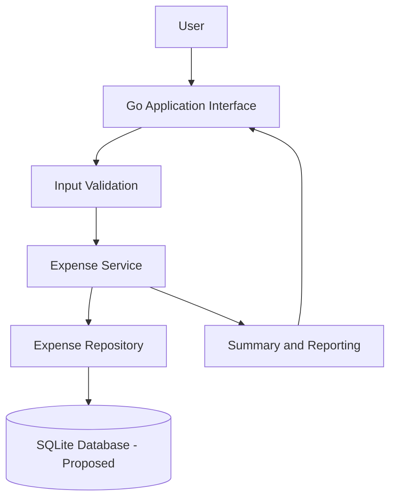
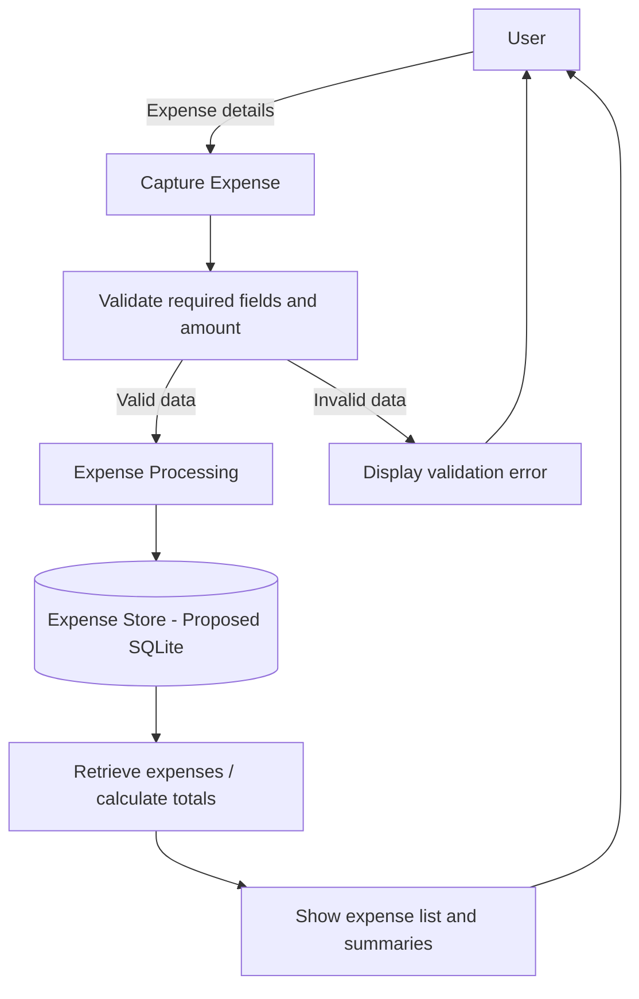

# Phase I: System Design

## High-level Architecture

## Data Flow Diagram

## Main Components

- **Application interface:** accepts user actions and presents results.
- **Input validation:** checks required fields and sensible expense amounts.
- **Expense service:** handles adding, listing, and summarizing expenses.
- **Expense repository:** separates storage operations from application logic.
- **Storage:** SQLite is the proposed local persistence option; final implementation may refine the design.
- **Summary module:** calculates totals and groups expenses by category.

These diagrams describe the proposed Phase I design. They should not be interpreted as proof that all modules have been implemented or tested.
